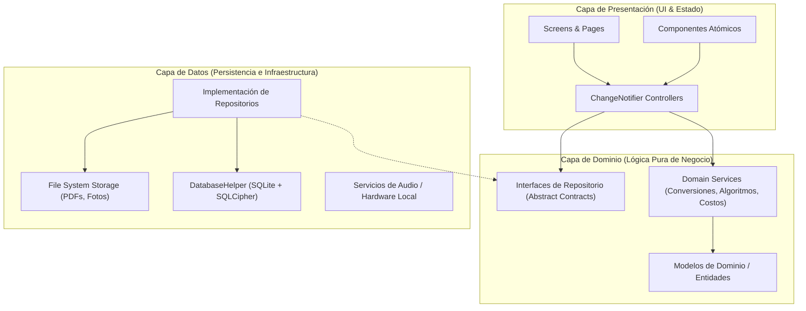
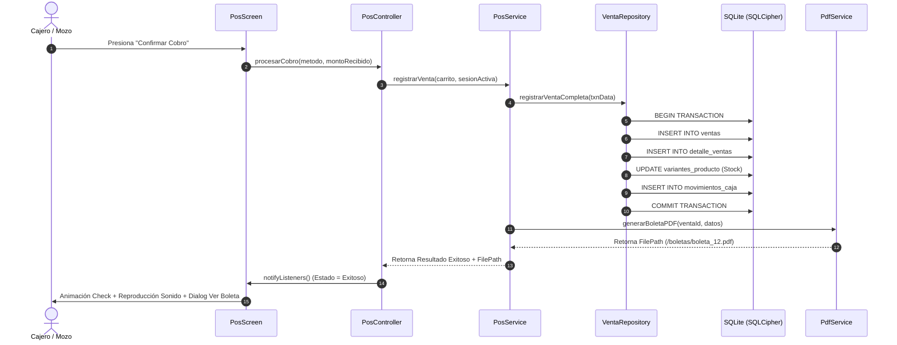
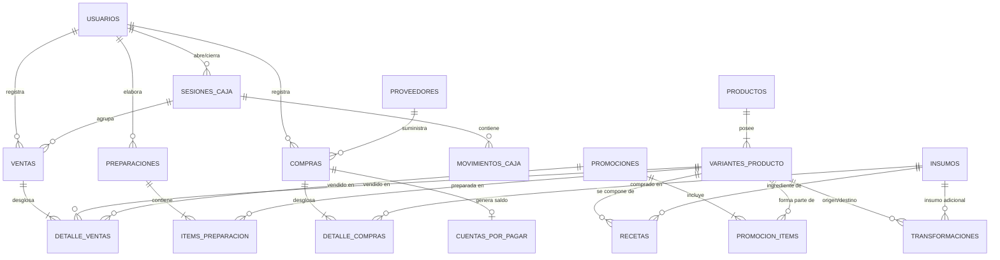

# DOCUMENTO DE DISEÑO DE SOFTWARE (SDD) — KIMI PIZZA
**Documento:** SDD-2026-V2.0  
**Estándar:** IEEE Std 1016-2009 / Lucid Software Design Guide  
**Proyecto:** KIMI PIZZA — Sistema POS, Producción y ERP Offline-First  
**Fecha:** Octubre 2026  
**Estado:** Arquitectura de referencia para la evolución de la aplicación  

---

## 1. INTRODUCCIÓN Y METAS ARQUITECTÓNICAS

### 1.1 Propósito
El presente documento describe la arquitectura de referencia, la descomposición en capas, los patrones de diseño, el modelo de datos relacional y los protocolos de comunicación interna para la evolución de **KIMI PIZZA**. La estructura y los patrones aquí descritos son objetivos de diseño; antes de modificar una funcionalidad, verifica cómo está implementada actualmente en el código.

### 1.2 Metas de Diseño
1. **Desacoplamiento Estricto:** Independencia total entre la lógica de negocio y la interfaz de usuario Flutter.
2. **Atomicidad Transaccional (ACID):** Manejo riguroso de transacciones en SQLite para garantizar consistencia entre ventas, stock y caja.
3. **Autonomía Offline-First con Cifrado en Reposo:** Persistencia local mediante `sqflite_sqlcipher` (AES-256) sin requerir conectividad externa.
4. **Mantenibilidad y Extensibilidad:** Organización modular basada en características (`features/`) complementada por capas concéntricas (`core/`, `domain/`, `data/`, `presentation/`).

---

## 2. ARQUITECTURA GENERAL DEL SISTEMA

### 2.1 Diagrama de Capas (Clean Architecture)


### 2.2 Flujo de Datos y Reactividad
1. El usuario interactúa con un Widget (ej. presiona el botón "Cobrar Venta").
2. El Widget invoca un método en el `Controller` (`PosController.procesarCobro(...)`).
3. El `Controller` valida el estado de la UI y delega la ejecución al `PosService`.
4. El `PosService` ejecuta la lógica de dominio (validación de stock, cálculo de vuelto, asignación del ciclo de caja) y llama al `VentaRepository`.
5. El `VentaRepository` inicia una transacción atómica en `DatabaseHelper`:
   - Inserta la venta en la tabla `ventas`.
   - Inserta los ítems en `detalle_ventas`.
   - Descuenta el stock de las variantes en `variantes_producto`.
   - Registra el movimiento de caja en `movimientos_caja`.
6. Al completarse la transacción, el `PosService` genera el archivo PDF determinístico en almacenamiento local permanente mediante `PdfService`.
7. El `Controller` notifica a la UI (`notifyListeners()`) con la ruta del PDF generado.
8. La UI despliega la animación de éxito y reproduce el sonido local.

---

## 3. GESTIÓN DEL ESTADO Y DEPENDENCIAS

### 3.1 Patrón State Management: Provider + ChangeNotifier
Se adopta **Provider** con **ChangeNotifier** por su simplicidad, rendimiento nativo y nula sobrecarga en el bundle:
- Cada módulo funcional posee su propio controlador (`PosController`, `CajaController`, `InsumoController`, `PreparacionController`, `ReportesController`, `PromocionController`).
- Los controladores se inyectan en la raíz del árbol de widgets en `main.dart` mediante `MultiProvider`.
- Los widgets consumen el estado utilizando `Consumer<T>` para reconstrucciones quirúrgicas o `context.read<T>()` para disparar acciones sin causar rebuilds innecesarios.



---

## 4. DISEÑO DE BASE DE DATOS Y ESQUEMA RELACIONAL (DDL)

### 4.1 Diagrama Entidad-Relación (ERD)


### 4.2 Especificación de Tablas y Restricciones de Integridad

#### Tabla: `usuarios`
| Columna | Tipo | Restricción | Descripción |
|---|---|---|---|
| `id` | INTEGER | PK AUTOINCREMENT | Identificador único del usuario |
| `username` | TEXT | UNIQUE NOT NULL | Alias único para inicio de sesión |
| `password_hash`| TEXT | NOT NULL | Hash criptográfico de la contraseña (PBKDF2/SHA-256) |
| `salt` | TEXT | NOT NULL | Sal criptográfica aleatoria única |
| `nombre_completo`| TEXT| NOT NULL | Nombre y apellidos del colaborador |
| `rol` | TEXT | CHECK(rol IN ('admin', 'empleado')) | Rol persistido; el formulario presenta al empleado como cajero/preparador |
| `recovery_code_hash` | TEXT | NULLABLE | Hash del código de rescate alfanumérico |
| `activo` | INTEGER | NOT NULL DEFAULT 1 | 1 = Habilitado, 0 = Inactivo |

#### Tabla: `insumos`
| Columna | Tipo | Restricción | Descripción |
|---|---|---|---|
| `id` | INTEGER | PK AUTOINCREMENT | Identificador único del insumo |
| `nombre` | TEXT | UNIQUE NOT NULL | Nombre canónico de la materia prima |
| `categoria` | TEXT | NOT NULL | Categoría (Harinas, Quesos, Carnes, etc.) |
| `unidad_base` | TEXT | CHECK(unidad_base IN ('kg','g','l','ml','und','pqte')) | Unidad de referencia en inventario |
| `contenido_paquete` | REAL | DEFAULT 1 | Número de unidades contenidas por paquete |
| `stock_actual` | REAL | NOT NULL DEFAULT 0 | Existencias en tiempo real expresadas en unidad base |
| `stock_minimo` | REAL | NOT NULL DEFAULT 0 | Umbral de alerta para reabastecimiento |
| `costo_unitario_promedio` | REAL | NOT NULL DEFAULT 0 | Costo promedio ponderado derivado de compras |

#### Tabla: `variantes_producto`
| Columna | Tipo | Restricción | Descripción |
|---|---|---|---|
| `id` | INTEGER | PK AUTOINCREMENT | Identificador de la variante comercial |
| `producto_id` | INTEGER | FK -> productos(id) | Producto matriz al que pertenece |
| `nombre_variante` | TEXT | NOT NULL | Ej. "Personal 4 Porciones", "Mediana", etc. |
| `precio_venta` | REAL | NOT NULL | Precio de venta estándar al público |
| `stock` | INTEGER | NOT NULL DEFAULT 0 | Stock físico preparado listo para entrega |

#### Tabla: `recetas`
| Columna | Tipo | Restricción | Descripción |
|---|---|---|---|
| `id` | INTEGER | PK AUTOINCREMENT | Identificador del ítem de receta |
| `variante_id` | INTEGER | FK -> variantes_producto(id) | Variante que consume el insumo |
| `insumo_id` | INTEGER | FK -> insumos(id) | Insumo crudo requerido |
| `cantidad` | REAL | NOT NULL | Cantidad dosificada para la variante |
| `unidad_medida` | TEXT | NOT NULL | Unidad de formulación (g, ml, und) |
| *Índice Único* | UNIQUE(`variante_id`, `insumo_id`) | Regla Upsert | Impide insumos duplicados por receta |

#### Tabla: `sesiones_caja`
| Columna | Tipo | Restricción | Descripción |
|---|---|---|---|
| `id` | INTEGER | PK AUTOINCREMENT | Identificador de la sesión de caja |
| `fecha_apertura` | TEXT | NOT NULL | Timestamp ISO8601 de apertura |
| `ciclo_operativo` | TEXT | NOT NULL | Fecha YYYY-MM-DD del ciclo comercial |
| `monto_apertura` | REAL | NOT NULL DEFAULT 0 | Dinero inicial / fondo para vueltos |
| `usuario_apertura_id` | INTEGER | FK -> usuarios(id) | Colaborador que abrió el turno |
| `estado` | TEXT | CHECK(estado IN ('abierta', 'cerrada', 'reabierta')) | Estado del turno |
| `fecha_cierre` | TEXT | NULLABLE | Timestamp ISO8601 de cierre |
| `total_efectivo_sistema` | REAL | DEFAULT 0 | Efectivo teórico calculado por ventas/gastos |
| `total_yape_plin` | REAL | DEFAULT 0 | Ventas por billetera digital registradas |
| `efectivo_contado` | REAL | DEFAULT 0 | Dinero físico contado por el cajero (Arqueo Ciego) |
| `diferencia` | REAL | DEFAULT 0 | Diferencia financiera ($Contado - Teórico$) |
| `nota_cierre` | TEXT | NULLABLE | Observaciones o justificación de descuadre |

---

## 5. SUBSISTEMAS ESPECIALIZADOS Y MOTORES DE NEGOCIO

### 5.1 Motor de Conversión de Unidades (`ConversionesHelper`)
La clase estática `ConversionesHelper` centraliza la matemática de equivalencias:
```dart
class ConversionesHelper {
  static double convertir(double cantidad, String origen, String destino, {double factorPaquete = 1.0}) {
    final o = origen.toLowerCase().trim();
    final d = destino.toLowerCase().trim();
    if (o == d) return cantidad;

    // Masa: Kg <-> g
    if (o == 'kg' && (d == 'g' || d == 'gr')) return cantidad * 1000.0;
    if ((o == 'g' || o == 'gr') && d == 'kg') return cantidad / 1000.0;

    // Volumen: L <-> ml
    if ((o == 'l' || o == 'litro' || o == 'litros') && d == 'ml') return cantidad * 1000.0;
    if (d == 'ml' && (o == 'l' || o == 'litro' || o == 'litros')) return cantidad / 1000.0;

    // Conteo: Paquete <-> Unidades
    if ((o == 'pqte' || o == 'paquete') && (d == 'und' || d == 'unidad' || d == 'unidades')) {
      return cantidad * factorPaquete;
    }
    if ((o == 'und' || o == 'unidad' || o == 'unidades') && (d == 'pqte' || d == 'paquete')) {
      return factorPaquete > 0 ? cantidad / factorPaquete : 0.0;
    }

    throw ArgumentError('Unidades incompatibles: de $origen a $destino');
  }
}
```

### 5.2 Motor de Sugerencias de Preparación (`SugerenciasAlgorithm`)
El servicio `SugerenciasService` ejecuta la consulta histórica de ventas de los últimos 4 turnos que coincidan con el mismo día de la semana (`strftime('%w', fecha)`):
$$\text{Recomendación} = \max\left(0, \text{Round}\left( \bar{V}_{\text{mismo\_día}} + Faltantes - Sobrantes \right)\right)$$
- Si no hay datos históricos suficientes ($n < 2$), el algoritmo utiliza el promedio móvil de los últimos 7 días con un factor de seguridad del 10% adicional.

### 5.3 Motor de Boletas y Generación PDF (`PdfService`)
- Construido con la librería `pdf: ^3.13.1` y `printing: ^5.15.1`.
- Utiliza la fuente estándar Helvetica/Courier para garantizar renderizado determinístico sin depender de fuentes externas en el sistema operativo.
- El archivo se guarda en:
  ```
  Directory appDocDir = await getApplicationDocumentsDirectory();
  File file = File('${appDocDir.path}/boletas/boleta_$ventaId.pdf');
  await file.writeAsBytes(await pdf.save());
  ```
- **Apertura y Compartición:**
  - `OpenFilex.open(path)` para previsualización instantánea en el visor del sistema operativo.
  - `SharePlus.instance.share(ShareParams(files: [XFile(path)]))` para envío por WhatsApp, correo o Telegram.

---

## 6. SEGURIDAD Y PROTECCIÓN CRIPTOGRÁFICA

1. **Cifrado de la Base de Datos:**
   - La base de datos `pizzapp_secure.db` se abre exclusivamente mediante `openDatabase` de `sqflite_sqlcipher` con una llave de 256 bits derivada mediante PBKDF2 del identificador único del hardware y una sal de aplicación embebida.
2. **Generación del Recovery Kit:**
   - Cadena de 24 caracteres generada con `Random.secure()`, alfabeto `ABCDEFGHJKLMNPQRSTUVWXYZ23456789` (excluyendo caracteres visualmente ambiguos como 0, O, 1, I).
   - El hash se computa mediante `SHA-256(code + user_salt)`.
3. **Persistencia Segura de Credenciales:**
   - Para guardar la sesión del usuario activo se utiliza `flutter_secure_storage`, asegurando que el token de sesión esté protegido en el KeyStore de Android o Keychain de iOS.

---

## 7. ESTRATEGIA DE MANEJO DE ERRORES Y TOLERANCIA A FALLOS

1. **Prevención de Caídas por Excepciones Asíncronas:**
   - Todo bloque asíncrono con navegación o manipulación de context debe verificar `if (!mounted) return;`.
2. **Aislamiento de Audio:**
   - La reproducción del sonido de cobro exitoso se envuelve en un bloque `try-catch` silencioso. Una falla de hardware de audio jamás debe impedir que la venta se registre ni bloquear el diálogo de la boleta.
3. **Rollback Transaccional Automático:**
   - Toda transacción en `DatabaseHelper` que arroje una excepción de base de datos ejecuta automáticamente `ROLLBACK`, preservando la consistencia e integridad de las tablas.
