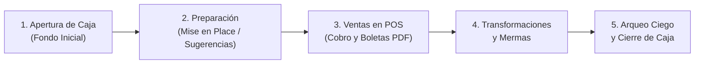

# MANUAL DE USUARIO OPERATIVO — KIMI PIZZA
**Documento:** MANUAL-OP-2026-V2.0  
**Dirigido a:** Propietarios, Administradores, Cajeros y Personal de Cocina  
**Plataforma:** Aplicación KIMI PIZZA (Android / iOS / Desktop)  
**Versión del Sistema:** 2.0.0 Offline-First  

---

## 1. INTRODUCCIÓN Y PRIMEROS PASOS

¡Bienvenido a **KIMI PIZZA**! Este sistema fue diseñado especialmente para pizzerías de alta rotación. Funciona **completamente sin conexión a internet**, por lo que nunca te quedarás sin poder cobrar o registrar pedidos aunque falle el WiFi o los datos móviles.

### 1.1 Primer Inicio (Configuración de la Cuenta Administrador)
Al abrir la aplicación por primera vez en un dispositivo nuevo:
1. En **Datos del negocio**, ingresa el **Nombre de la pizzería** y selecciona la moneda. El nombre queda guardado como configuración inicial y luego el administrador podrá editarlo.
2. Continúa a **Usuario administrador** e ingresa tu nombre completo, usuario y contraseña (mínimo 8 caracteres).
3. Selecciona una foto de perfil (opcional) y completa los datos solicitados.
4. Crea la cuenta y guarda la clave de rescate que aparece al terminar.

> [!CAUTION]
> **TU CLAVE DE RESCATE (EMERGENCY RECOVERY KIT):**
> Inmediatamente después de crear tu cuenta, aparecerá en pantalla una tarjeta de alta seguridad con un código de 24 letras y números divididos en 4 bloques:  
> **`EJEMPLO: 8K9W2A-MFP73L-9QR4VX-B2C5TD`**  
> **ANÓTALA EN UN CUADERNO SEGURO O TOMA UNA FOTO**. Si alguna vez olvidas tu contraseña, esta clave es la **ÚNICA** forma de recuperar el acceso a tu sistema sin perder las ventas ni los datos de tu pizzería.

---

## 2. CONFIGURACIÓN DEL NEGOCIO Y CÓDIGO QR DE PAGOS

Solo el **administrador** configura los datos del negocio:

1. Desde el Dashboard, abre el **menú lateral** con el botón ☰.
2. Selecciona **Configuración del negocio**.
3. Revisa o actualiza el nombre comercial (se ingresó en el primer inicio) y completa, si corresponde, RUC o DNI, dirección, teléfono y mensaje al pie de la boleta.
4. Para configurar cobros digitales, toca **Subir imagen QR** y elige desde la galería una imagen clara del QR de Yape, Plin o la cuenta bancaria.
5. Pulsa **Guardar cambios**. El QR estará disponible en el POS al seleccionar Yape/Plin. Puedes quitarlo desde esta misma pantalla.

Los datos opcionales que se dejen vacíos no aparecen en la cabecera de la boleta. El mensaje del pie usa uno predeterminado si no se configura otro.

El menú lateral se mantiene reducido a **Configuración del negocio**, **Gestión de usuarios** y **Copias de seguridad**. Los módulos de operación siguen disponibles en el Dashboard.

---

## 3. EL CICLO DE TRABAJO DIARIO (PASO A PASO)

El trabajo diario en la pizzería sigue una secuencia lógica de 5 pasos diseñada para que el inventario y el dinero cuadren al centavo:

---

### PASO 1: Apertura de Caja (Inicio de Turno)
Antes de poder realizar cualquier venta, el cajero o administrador debe abrir la caja del turno:
1. Al ingresar al sistema, toca el botón de acceso rápido **"Apertura de Caja"** en el Dashboard.
2. Ingresa el **Monto de Apertura** (el dinero en efectivo inicial que dejas en el cajón para dar cambio o vuelto a los primeros clientes, ej. `S/ 100.00`).
3. Presiona **"Abrir Caja"**.
4. ¡Listo! La caja queda en estado **Abierta** y el Terminal POS se desbloquea de inmediato.

---

### PASO 2: Preparación de Cocina (Mise en Place) y Sugerencias IA
> **Antes de entrar a Preparación:** debe existir una caja abierta. Si está cerrada, ábrela en **Caja** y vuelve a Preparación.

Antes de abrir las puertas al público, el maestro pizzero o ayudante de cocina prepara las bases de pizza o pizzas pre-armadas:
1. En el Dashboard, toca **"Sugerencias Inteligentes"**:
   - El sistema analiza automáticamente las ventas históricas de los mismos días anteriores y te muestra cuántas pizzas te recomienda preparar de cada sabor (ej. *"Americana: Sugerencia 15 | Hawaiana: Sugerencia 10"*).
   - Si estás de acuerdo, presiona el botón flotante **"Aplicar Sugerencias a Preparación de Hoy"**.
2. En la pantalla **"Preparación de Hoy"**:
   - Si aparece **"Tienes productos del día anterior"**, revisa cada sobrante y selecciona **Preparación** para añadir una cantidad al campo de hoy o **Merma** para marcarla como pérdida.
   - Esas elecciones quedan en borrador. Puedes añadir cantidades nuevas o corregir el total antes de guardar; los cambios se aplican juntos al pulsar **"Guardar Preparación"**.
   - Puedes ajustar las cantidades con los botones `+` y `-`.
   - Si un sabor no se preparó por adelantado pero durante la noche hubo mucha demanda imprevista, puedes registrar **números negativos** para documentar que hubo un "faltante" de preparación.
   - Presiona **"Guardar Preparación"**: El sistema incrementará el stock disponible para venta en el POS y descontará automáticamente de la despensa los insumos correspondientes según sus recetas.

#### Registrar una gaseosa de 3 litros y servirla por vaso

1. En **Insumos → Nuevo insumo**, registra `Gaseosa` en categoría **Bebidas**, con unidad de stock **Litros**.
2. En **Compras → Nueva compra**, selecciona `Gaseosa`, ingresa cantidad `3` y el costo total de la botella. Guarda la compra para sumar los 3 litros al stock.
3. Registra `Vaso descartable` como insumo de categoría **Empaques**, con unidad **Paquetes**. Cuando aparezca el campo de contenido, ingresa cuántos vasos trae el paquete (por ejemplo, `50`).
4. En **Compras**, registra cuántos paquetes compraste —por ejemplo, `1`— y el costo total.
5. En **Productos**, crea un producto de categoría **Bebidas**, por ejemplo `Gaseosa`, y una variante cuyo nombre incluya `Vaso`, como `Vaso pequeño`. Configura el precio de venta de esa variante.
6. Abre la receta de esa variante y agrega la cantidad de gaseosa que realmente se sirve, en **ml**, y `1` **Unidad** del insumo `Vaso descartable`. No ingreses un tamaño supuesto: usa la porción real del negocio.
7. En el POS, selecciona **Vaso pequeño**. La app lo presenta como `1 vaso de Gaseosa`; marca **Cortesía** si se entregará gratis. Al confirmar, tanto la venta normal como la cortesía consumen los mililitros configurados y un vaso.

Por ejemplo, con `3 L` de gaseosa, receta de `250 ml` y paquete de `50` vasos, cada unidad consume `0.25 L` y `1/50` de paquete. Los 250 ml son solo una referencia; registra la cantidad real servida.

---

### PASO 3: Ventas en el Mostrador (Punto de Venta - POS)
1. Toca el botón **"Vender (POS)"**.
2. **Seleccionar Productos:** Toca sobre la pizza o bebida que desea el cliente. Si tiene variantes (Personal, Mediana, Familiar), se abrirá un selector para elegir el tamaño.
3. **Modificar ítems en el Carrito:**
   - Puedes subir o bajar la cantidad.
   - **Precio editable:** Si deseas hacer un descuento especial o precio acordado a ese cliente, puedes modificar el precio en ese momento tocando el valor, sin alterar el precio de lista de tu menú.
   - **Bebidas de Cortesía:** Si le regalas una bebida al cliente por fidelización, marca la casilla **"Cortesía"**. La boleta saldrá en S/ 0.00 para ese producto, pero el stock del almacén se descontará correctamente.
4. **Cobrar:** Toca el botón verde **"Cobrar (S/ Total)"**:
   - **Si paga en Efectivo:** Escribe el monto con el que te paga el cliente en el campo *"Se pagó con"*. El sistema te indicará en letras grandes y en color verde el **Vuelto exacto** que debes entregar.
   - **Si paga con Yape / Plin:** Toca la opción *"Yape / Plin"*. Si el administrador configuró el QR, se mostrará para que el cliente lo escanee; toca la imagen para ampliarla. Si no aparece, solicita al administrador que lo configure desde **Configuración del negocio**.
5. **Confirmación:**
   - Presiona **"Confirmar Venta"**.
   - Sonará un pitido de confirmación y aparecerá una animación verde de verificación (Check).
   - En el cuadro que aparece, puedes presionar **"Ver Boleta"** para visualizar el ticket digital o **"Descargar / Compartir"** para enviárselo al cliente por WhatsApp.
   - La boleta muestra el monto recibido y vuelto si ingresaste cuánto pagó el cliente. También presenta el IGV del 18 % incluido en el precio, junto con la base imponible.

---

### PASO 4: Transformaciones de Pizzas en Vivo y Mermas

#### ¿Qué hacer si te piden una pizza que no tienes pre-armada? (Transformación)
Si un cliente pide una **Pizza Hawaiana Familiar**, pero en tu vitrina de preparadas solo te quedan **Pizzas Americanas Familiares**:
1. El pizzero toma una Americana y le agrega piña.
2. En el sistema, vas a la sección **"Transformación"**:
   - Origen: *Pizza Americana Familiar*.
   - Destino: *Pizza Hawaiana Familiar*.
   - Insumo adicional consumido: *100 gramos de Piña*.
3. Presionas **"Realizar Transformación"**.
4. El sistema restará 1 Americana, sumará 1 Hawaiana y descontará 100 gramos de piña de tus insumos, ¡todo en 3 segundos y sin descuadrar nada!

#### Registro de Mermas (Desperdicios)
Si se quema una masa en el horno, se rompe una botella o un ingrediente se echa a perder:
1. Ingresa a **"Mermas"** $\rightarrow$ **"Nueva Merma"**.
2. Elige si es un insumo crudo (ej. Queso Mozzarella) o una pizza preparada.
3. Ingresa la cantidad desperdiciada y selecciona el motivo (*Vencimiento*, *Caída/Rotura*, *Error de Cocina*).
4. Guarda el registro: El sistema restará la cantidad del inventario y lo sumará a tus costos por pérdidas para que sepas exactamente cuánto dinero se pierde por mermas en tu balance mensual.

---

### PASO 5: Arqueo Ciego y Cierre de Caja (Fin de Turno)

> [!NOTE]
> **HORARIOS NOCTURNOS:** Si tu pizzería abrió a las 18:00 del viernes y estás cerrando a las 02:30 de la madrugada del sábado, **no te preocupes**. El sistema sabe que estás cerrando el turno del viernes y todas tus ventas pertenecerán a ese mismo día de trabajo.

1. Ve a **"Cierre de Caja"**.
2. **Arqueo Ciego:** El cajero debe contar los billetes y monedas que tiene en el cajón de dinero e ingresar el monto total en el campo **"Efectivo Contado Real"**. (El sistema no le muestra cuánto dinero debería haber para evitar trampas).
3. Ingresa también el total de pagos recibidos por **Yape / Plin** revisando las notificaciones del teléfono del negocio.
4. Presiona **"Verificar Balance"**:
   - **Verde (Diferencia S/ 0.00):** La caja cuadró perfectamente.
   - **Rojo (Diferencia Negativa, ej. S/ -15.00):** Falta dinero en el cajón físico con respecto a las ventas del sistema.
   - **Naranja (Diferencia Positiva, ej. S/ +10.00):** Hay más dinero en el cajón del que se registró en ventas (dinero sobrante).
5. Escribe una nota u observación si hubo alguna discrepancia y presiona **"Cerrar Caja Definitivamente"**.
6. Se generará de inmediato el **Reporte de Arqueo en PDF** listo para ser revisado por el dueño.

---

## 4. REPORTES Y ESTADO DE GANANCIAS Y PÉRDIDAS (P&L)

Como dueño o administrador, puedes consultar en cualquier momento la salud financiera de tu pizzería:
1. Ingresa al módulo **"Reportes"**.
2. Elige el periodo que deseas analizar con los botones superiores: *"Hoy"*, *"Ayer"*, *"Esta Semana"*, *"Este Mes"* o toca *"Personalizado"* para elegir un rango de fechas en el calendario.
3. Observa las cuatro tarjetas clave:
   - **Ingresos Totales (Verde):** Todo el dinero facturado por ventas.
   - **Costo de Mercadería / COGS (Naranja):** Lo que te costó la materia prima (harina, queso, carnes, empaques) de las pizzas que realmente vendiste.
   - **Gastos Operativos (Rojo):** Compras al contado, sueldos, compras de insumos menores y mermas.
   - **Beneficio Neto (Verde/Rojo):** Tu ganancia limpia real en el periodo ($\text{Ingresos} - \text{Costos} - \text{Gastos}$).
4. Presiona el botón flotante **"Exportar PDF"** para obtener un informe profesional impreso o para compartirlo con tu contador.

---

## 5. PREGUNTAS FRECUENTES (FAQ) Y SOLUCIÓN DE PROBLEMAS

**P: ¿Qué pasa si se apaga el teléfono o se corta la luz mientras estoy cobrando?**  
*R:* No te preocupes. KIMI PIZZA guarda cada operación en una base de datos segura SQLite con transacciones atómicas. Al encender el equipo, todo tu inventario y ventas estarán exactamente donde los dejaste.

**P: ¿Puedo usar la aplicación en dos teléfonos a la vez?**  
*R:* En esta versión Offline-First, cada dispositivo opera de manera local y autónoma para garantizar máxima velocidad e inmunidad a fallos de internet. Recomendamos destinar un dispositivo fijo como terminal principal de caja.

**P: ¿Cómo reimprimo una boleta que ya cobré hace horas?**  
*R:* En la pantalla del POS, toca el ícono del recibo en la barra superior (`Icons.receipt_long`) o ingresa a *"Historial de Ventas"*. Verás la lista de todas las boletas del turno; puedes tocar el ícono de ojo para verla o el ícono de compartir para reenviarla.

---

## 6. USUARIOS, PERFIL Y RECUPERACIÓN

- Desde el menú lateral, abre **Mi perfil** para editar los datos personales disponibles y cerrar sesión. Solo la administradora puede configurar o renovar la clave de rescate desde su perfil. El QR y los datos de la pizzería no se editan desde el perfil.
- La administradora puede abrir **Gestión de usuarios** para crear o editar cuentas, asignar el rol disponible, bloquear/desbloquear y dar de baja usuarios.
- Solo la administradora ve y puede abrir **Configuración del negocio**; los empleados no pueden cambiar estos datos ni el QR.
- La clave de rescate se muestra una sola vez al generarla. Guárdala fuera del teléfono; no se envía por correo.
- Si la administradora olvida su contraseña, desde la pantalla de inicio de sesión puede restablecerla con su usuario y clave de rescate. La clave de la copia de seguridad es independiente.

## 7. COPIAS DE SEGURIDAD Y CAMBIO DE TELÉFONO

### Exportar una copia para transferir

1. Desde el Dashboard, abre el **menú lateral**, selecciona **Copias de seguridad** y elige exportar.
2. Crea y confirma una contraseña de al menos 12 caracteres. Esta contraseña protege la copia y no es la contraseña de acceso a KIMI PIZZA.
3. Guarda el archivo `.kpzbackup` fuera del teléfono (por ejemplo, en una computadora o almacenamiento personal) y conserva la contraseña por separado.

### Restaurar una copia portátil

1. En el teléfono que recibirá los datos, selecciona **Restaurar una copia** desde la bienvenida/inicio de sesión.
2. Elige el archivo `.kpzbackup`, escribe su contraseña y confirma el reemplazo de los datos actuales.
3. La app genera una copia local previa y, al finalizar, vuelve al inicio de sesión.

### Copia local automática

La app crea copias locales cifradas diarias y conserva hasta siete en el mismo teléfono. Sirven para recuperar ese dispositivo, no para migrar si se pierde o se reemplaza el teléfono. Para migrar se necesita el archivo portátil y su contraseña.
